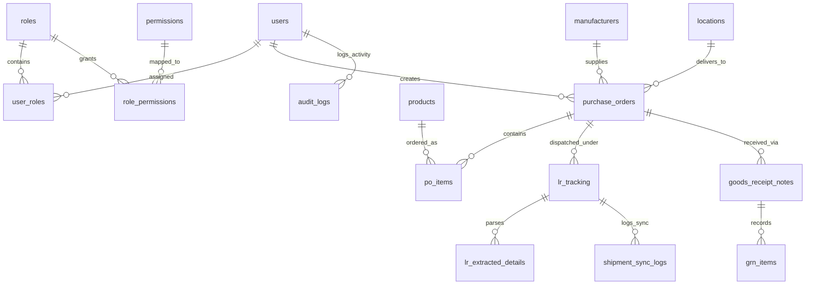

# Database Architecture Specification (DATABASE) — BSC Exclusive POMS

> **Target Engine**: MariaDB 11.8.9-log / MySQL 8.x  
> **Default Collation**: `utf8mb4_unicode_ci`  
> **Character Set**: `utf8mb4`  
> **Connection Pooler**: `mysql2` (Max 10 connections, keep-alive enabled)

---

## 1. Relational Schema Overview & Conventions

The database contains **60 production tables** organized into core business domains:
- **Identity & RBAC**: `users`, `roles`, `user_roles`, `permissions`, `role_permissions`, `user_sessions`, `password_resets`.
- **Master Data Hierarchy**: `divisions`, `departments`, `categories`, `product_types`, `brands`, `products`, `product_variants`, `colors`, `sizes`, `manufacturers`, `locations`.
- **Procurement & Orders**: `purchase_orders`, `po_items`, `po_approvals`, `po_attachments`, `po_status_history`, `number_sequences`.
- **Logistics & Shipments**: `lr_tracking`, `lr_extracted_details`, `lr_audit_logs`, `shipment_sync_logs`, `goods_receipt_notes`, `grn_items`.
- **Enterprise Operations**: `audit_logs`, `notifications`, `import_records`, `company_settings`, `chats`, `chat_messages`.

---

## 2. Entity Relationship Diagram (ERD — Key Core Tables)



---

## 3. MariaDB 11.8 Engine Compatibility & Collation Fixes

### 3.1 Resolving Error 1901 (`VIRTUAL` Column Expression Constraint)
In earlier revisions, schema files attempted to use MySQL 8-specific expressions such as:
```sql
-- INVALID ON MARIADB 11.8 (Raises ER_GENERATED_COLUMN_FUNCTION_IS_NOT_ALLOWED)
`parent_category_id_uk` varchar(64) GENERATED ALWAYS AS (ifnull(`parent_category_id`,'')) VIRTUAL
```
**Applied Solution**: Replaced synthetic virtual columns with composite standard indices:
```sql
-- MariaDB 11.8 Standard
UNIQUE KEY `uk_categories_parent_name` (`parent_category_id`, `name`)
```

### 3.2 Global Collation Standardization
MariaDB 11.8 does not support MySQL 8's default `utf8mb4_0900_ai_ci`. All 60 database tables have been explicitly migrated to `utf8mb4_unicode_ci` to prevent join collation mismatches (`ER_CANT_AGGREGATE_2COLLATIONS`).

---

## 4. Migration Safeguards & Version History

Migrations are executed sequentially via `backend/src/autoMigrate.js`:

| Migration File | Description | Safeguard Applied |
| :--- | :--- | :--- |
| `001_schema.sql` | Base DDL for core tables and constraints | Uses `CREATE TABLE IF NOT EXISTS` |
| `002_views.sql` | Analytical and reporting views | Replaced with standard views |
| `003_rbac_seed.sql` | Default system roles and permissions | Seeded idempotently via `INSERT IGNORE` |
| `004_catalog_seed.sql`| Initial division, department, and category data | Seeded idempotently |
| `005_lr_tracking.sql`| LR tracking, extraction, and sync tables | `utf8mb4_unicode_ci` enforced |
| `006_users_departments.sql`| Supervisor department scoping tables | Composite keys verified |
| `007_collation_fix.sql` | Fixes MariaDB collations across all tables | Scripted `ALTER TABLE ... CONVERT TO` |
| `008_remove_uk_columns.sql` | Drops non-functional `_uk` generated columns | Removes legacy virtual columns |

---

## 5. Indexing & Query Optimization Matrix

| Table | Index Name | Columns Indexed | Query Target |
| :--- | :--- | :--- | :--- |
| `purchase_orders` | `idx_po_status_created` | `(status, created_at)` | Dashboard metrics & queues |
| `purchase_orders` | `idx_po_location` | `(location_id, created_at)` | Branch performance filters |
| `po_items` | `idx_poi_poid` | `(po_id)` | PO Details line loading |
| `lr_tracking` | `idx_lr_number` | `(lr_number)` | Fast live status tracking |
| `lr_tracking` | `idx_lr_status_synced` | `(status, last_synced_at)` | 20m background sync worker |
| `audit_logs` | `idx_audit_entity` | `(entity_type, entity_id)` | PO revision and history tabs |
| `user_sessions` | `idx_sessions_token` | `(token_hash, expires_at)` | Real-time auth verification |
