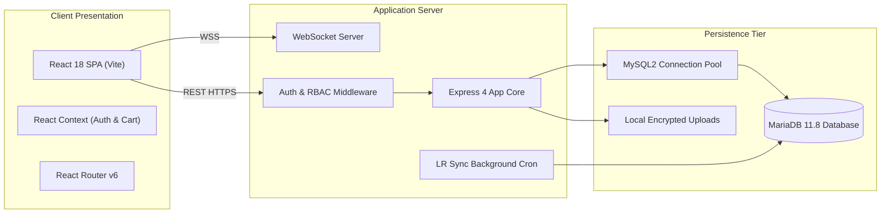

# System Design Document (DESIGN) — BSC Exclusive POMS

> **Architecture Style**: Modular Service-Oriented Monolith (Node.js/Express + React 18 SPA)  
> **Target Cloud Environment**: Hostinger Linux Cloud (LiteSpeed Web Server + MariaDB 11.8)

---

## 1. High-Level Architecture (HLD)

The application separates presentation from business logic while maintaining single-repository deployment velocity.



---

## 2. Low-Level Component Design (LLD)

### 2.1 Backend Modules & Services
- **Database Wrapper (`backend/src/db.js`)**: Implements query parameter translation (`$1, $2` to `?`), auto-reconnection with exponential backoff, transaction wrappers (`db.transaction()`), and datetime normalization to Asia/Kolkata (`+05:30`).
- **Schema Auto-Migrator (`backend/src/autoMigrate.js`)**: Runs at server boot, checks `migrations` table, applies pending `.sql` migration files in transactions, and seeds default administrative accounts (`admin@bsctextiles.in` / `Admin@123`).
- **Keep-Alive Daemon (`backend/src/server.js`)**: Internal loop executing every 240 seconds against `/api/health`, preventing LiteSpeed `lsnode` from issuing idle SIGTERM signals after 300s of inactivity.
- **Transporter Adapter Pattern (`backend/src/services/transporterRegistry.js`)**: Decouples carrier-specific tracking protocols behind a common interface:
  ```javascript
  class BaseTransporterAdapter {
    async validateLR(lrNumber) { /* ... */ }
    async fetchLiveTracking(lrNumber) { /* ... */ }
  }
  ```

### 2.2 Frontend State & Component Hierarchy
- **Context Boundaries**:
  - `AuthProvider`: Encapsulates user session, token storage in `localStorage`, role resolution, and location switching (`All Locations`, `BEL`, `DVG`, `SHI`).
  - `CartProvider`: Manages staging cart for bulk purchase order generation.
- **Atomic Components**:
  - `Sidebar.jsx`: Dynamic collapsable rail with auto-discovering department categories, mobile drawer, and role-based link trimming.
  - `Topbar.jsx`: Global search, live WebSocket notification bell, date/time ticker, and profile dropdown.
  - `DateRangeBar.jsx`: Unified date-range filtering component with standard presets (`All Time`, `Today`, `This Week`, `This Month`, `Custom Range`).
  - `DataTable.jsx`: Responsive, accessible data table with sortable columns, pagination, and empty state fallbacks.

---

## 3. SOLID & Architectural Principles Applied

1. **Single Responsibility Principle (SRP)**: Each Express route file (`auth.js`, `purchaseOrders.js`, `lrTracking.js`) is strictly isolated to its domain.
2. **Open/Closed Principle (OCP)**: Adding a new logistics carrier requires only subclassing `BaseTransporterAdapter` and registering in `transporterRegistry.js` without altering core tracking routes.
3. **Liskov Substitution Principle (LSP)**: All logistics adapters conform to identical method signatures and error envelopes.
4. **Interface Segregation Principle (ISP)**: Frontend UI distinguishes between heavy analytics interfaces and lean Purchase Executive workspaces.
5. **Dependency Inversion Principle (DIP)**: Database access is abstracted via the centralized query interface in `db.js`, enabling painless mock injection during unit tests.

---

## 4. Error Handling & Resilience Strategy

- **Backend**: Centralized `errorHandler` middleware catches uncaught route exceptions, normalizes validation errors to `{ ok: false, error: '...' }`, and prevents sensitive stack traces from leaking to client responses.
- **Frontend**: Global `ErrorBoundary` wraps route definitions, rendering a graceful recovery fallback rather than crashing the entire SPA.
- **Database**: Deadlock retry logic automatically re-attempts transient MariaDB transaction rollbacks up to 3 times before raising a failure.
